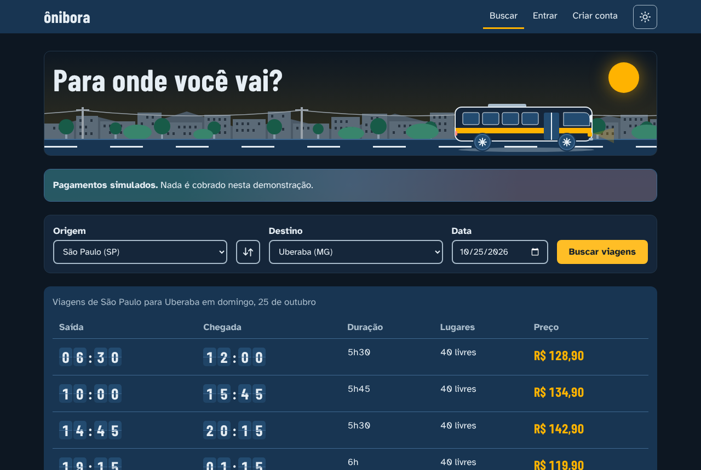
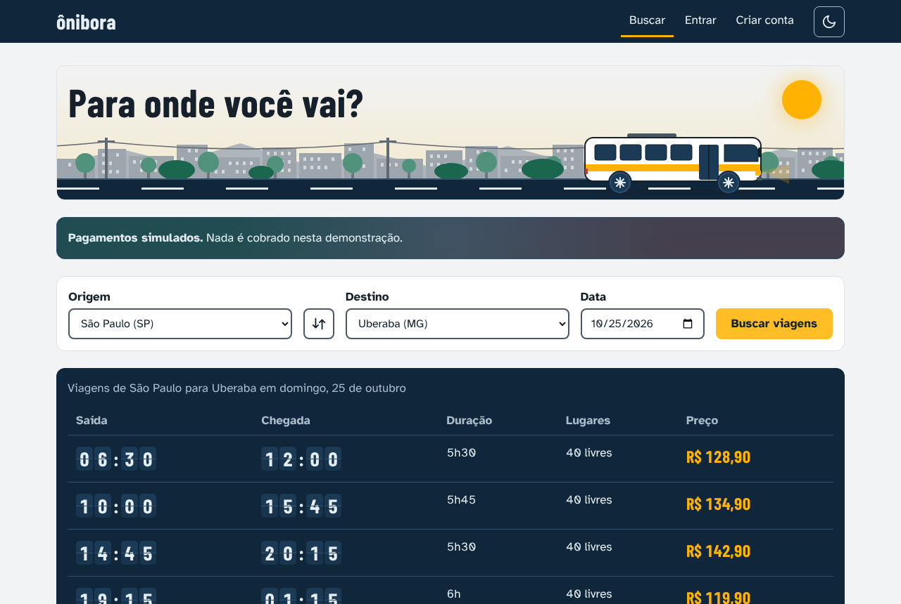
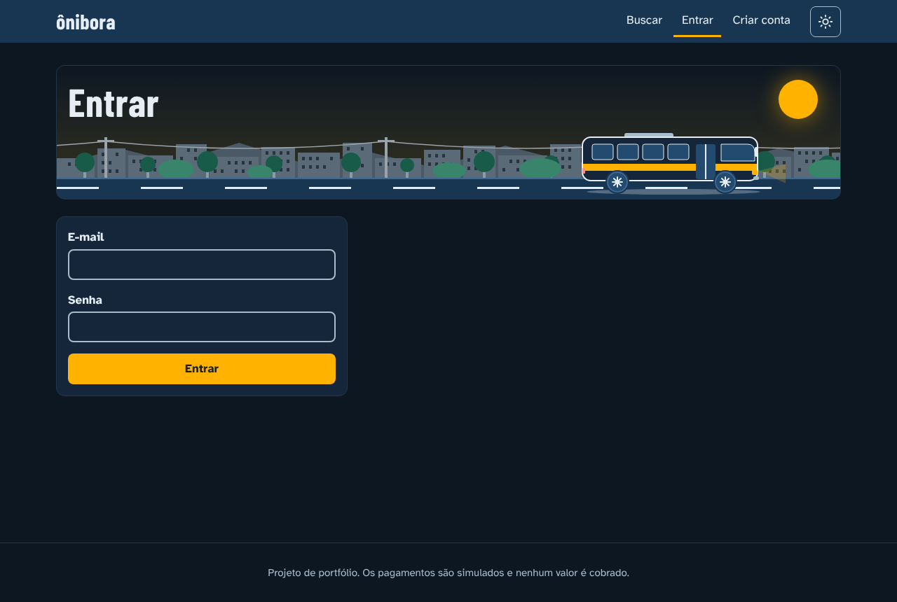
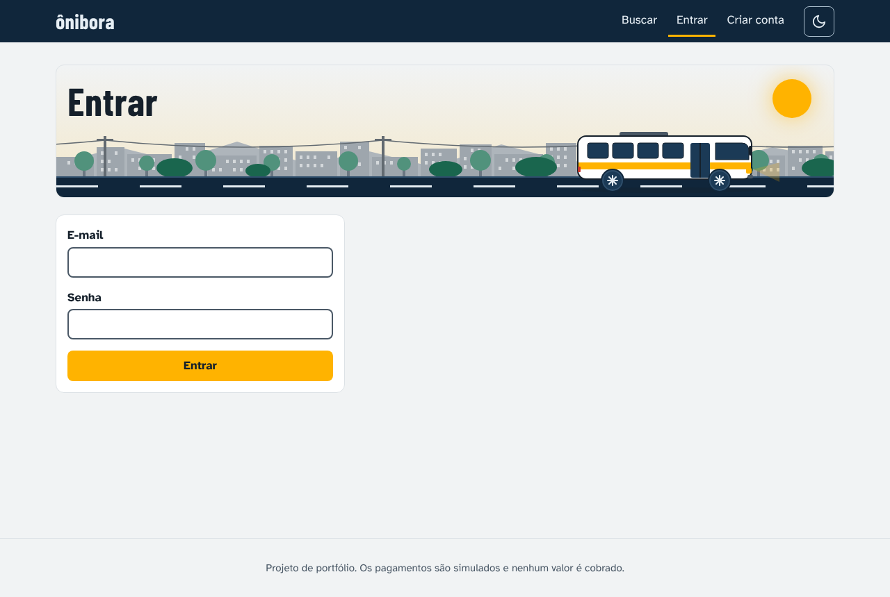
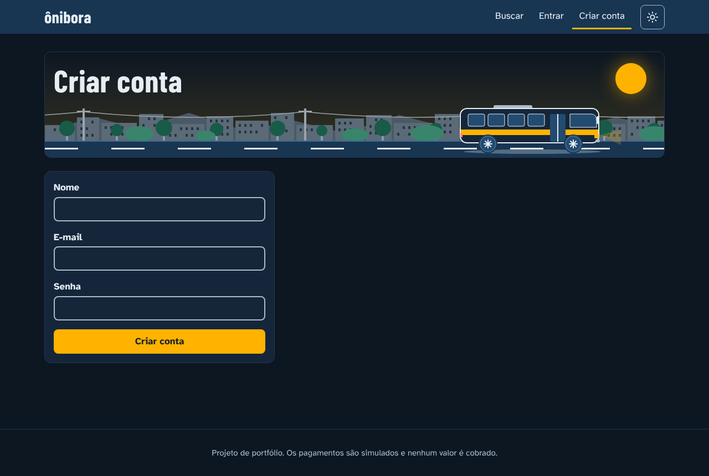
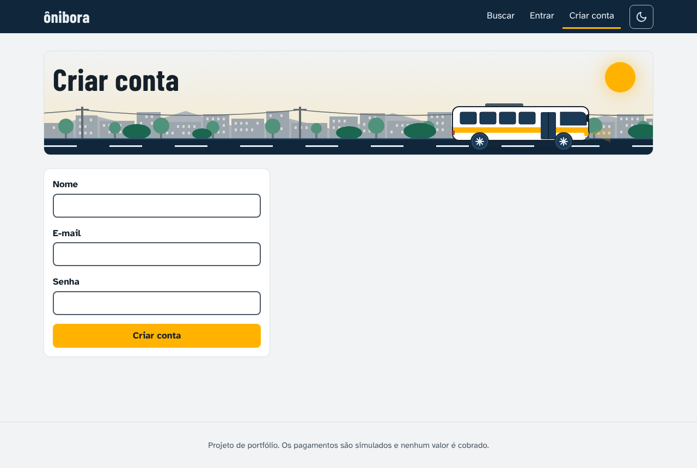
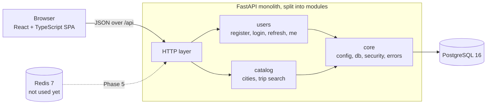

# bus-ticket-api

Intercity bus ticket sales, built as a portfolio project with one goal: **two passengers must never buy the same seat on the same leg of a trip.** The backend is where the interesting problems live (concurrency, consistency, idempotency); the React front end exists to make them visible.

Português: [README.pt-BR.md](README.pt-BR.md)

> **Status:** Phase 1 of 6 (`v0.1.0`). Catalog, trip search, accounts with JWT login and a React front end are done. Seat holds, payments and real-time seat maps come in the next phases. See the [roadmap](#roadmap).

## Screenshots

The front end is called **Ônibora**. It follows the system theme and has a manual toggle. The pages below are rendered against a mocked API with fictional data.

| Dark | Light |
| --- | --- |
|  |  |
|  |  |
|  |  |

## What works today

- **Trip search** by origin, destination and date. The price of a trip is the sum of the per-leg prices between the two cities.
- **Accounts**: sign up (automatic sign-in afterwards), sign in, sign out, session restored on reload.
- **Authentication** with a short-lived access token and a rotating refresh token ([ADR 0003](docs/adr/0003-autenticacao-access-curto-e-refresh.md)).
- **Front end** with a flap-style departure board, a route scene in the page header, a reduced-motion mode and keyboard and screen-reader support.
- **Seed script** that creates 4 cities, one route (São Paulo to Uberaba, with Campinas and Ribeirão Preto as stops) and 7 days of trips at 08:00 and 23:00, 40 seats each.

## Architecture



- A **modular monolith**: one deployable, with module boundaries that can be split later ([ADR 0001](docs/adr/0001-monolito-modular.md)).
- **PostgreSQL decides** every race. Registration and refresh-token rotation already rely on unique constraints and a single atomic `UPDATE`, not on checks in application code. Seat reservation will follow the same rule.
- **Redis** is in the Compose file but unused until the real-time seat map (Phase 5).
- The front end lives in [`web/`](web/) ([ADR 0002](docs/adr/0002-front-react-typescript.md)).

### API

| Method | Path | Description |
| --- | --- | --- |
| GET | `/health` | Liveness check |
| GET | `/api/cities` | List cities |
| GET | `/api/trips?origin=<id>&destination=<id>&date=YYYY-MM-DD` | Search trips |
| POST | `/api/auth/register` | Create an account |
| POST | `/api/auth/login` | Sign in; returns the access token and sets the refresh cookie |
| POST | `/api/auth/refresh` | Rotate the refresh token and return a new access token |
| POST | `/api/auth/logout` | Revoke the refresh token |
| GET | `/api/auth/me` | Current user (needs the access token) |

Interactive docs are served at `/docs` while the API is running. Domain errors use the shape `{ "code": "...", "message": "..." }`.

## Tech stack

- **Backend:** Python 3.12+, FastAPI, SQLAlchemy 2 (sync, psycopg 3), Alembic, Pydantic, argon2-cffi, PyJWT
- **Data:** PostgreSQL 16, Redis 7 (both through Docker Compose)
- **Front end:** React 19, TypeScript, Vite, React Router, GSAP, plain CSS with design tokens
- **Quality:** pytest, ruff, Vitest + Testing Library, ESLint, Prettier, GitHub Actions (jobs `ci` and `web`)

## Running it locally

**Requirements:** Python 3.12+, Node.js 24, Docker (with Compose).

```bash
git clone https://github.com/Prabovn7/bus-ticket-api.git
cd bus-ticket-api
```

**1. Configure the environment.** Copy the example file and edit it. The example `JWT_SECRET` is a short placeholder that the app rejects on purpose: use at least 32 random characters.

```bash
cp .env.example .env            # PowerShell: Copy-Item .env.example .env
python -c "import secrets; print(secrets.token_urlsafe(32))"   # paste the output as JWT_SECRET
```

Also change `POSTGRES_PASSWORD`. Never commit `.env`.

**2. Start PostgreSQL and Redis.**

```bash
docker compose up -d
```

**3. Install the backend, create the schema and load the catalog.**

```bash
python -m venv .venv
source .venv/bin/activate       # PowerShell: .venv\Scripts\Activate.ps1
pip install -r requirements-dev.txt

alembic upgrade head
python -m scripts.seed
```

The seed can be run more than once.

**4. Run the API** (http://127.0.0.1:8000, docs at `/docs`).

```bash
uvicorn app.main:app --reload
```

**5. Run the front end**, in another terminal. The dev server proxies `/api` to the API on port 8000.

```bash
cd web
npm ci
npm run dev
```

Open the URL Vite prints (http://localhost:5173 by default), search São Paulo to Uberaba for today, then create an account.

### Tests and checks

```bash
# Backend (Docker must be running; the test database is created automatically)
pytest
ruff check .

# Front end, from web/
npm test
npm run lint
npm run format:check
npm run build
```

The same checks run in GitHub Actions on every pull request.

## Roadmap

| Phase | Scope | Status |
| --- | --- | --- |
| 1 | Project structure, Compose, catalog with seed, trip search, accounts with JWT, CI, front end for search, sign up and sign in | Done (`v0.1.0`) |
| 2 | 10-minute seat hold on the full trip. Starts with a naive version, shows the 100-request test failing, then fixes it with `UNIQUE(trip_id, seat_number, leg_index)` and `INSERT ... ON CONFLICT`; lazy and active expiry | Next |
| 3 | Idempotent payment (`Idempotency-Key`) with a simulated gateway, reconciliation and cancellation | Planned |
| 4 | Reservation by leg (A to B to C to D), per-leg pricing, overlap tests | Planned |
| 5 | Real-time seat map (SSE + Redis pub/sub) | Planned |
| 6 | Deploy with CI/CD, Dockerfile and `api` service in Compose, Locust results | Planned |

The key test of the project: **100 simultaneous requests for the same seat and leg, exactly one succeeds.**

## Limitations and next steps

Known gaps in this version, kept here on purpose. Each one is either planned or a conscious trade-off.

**Authentication and security**

- The access token cannot be revoked before it expires (15 minutes). Signing out revokes the refresh token only.
- There is no rate limit on login yet. It is planned for Phase 6, together with Redis.
- There is no absolute session cap: the 24-hour refresh window slides on every use.
- The `refresh_tokens` table is never cleaned up.
- Two browser tabs renewing the session at the same moment can revoke the whole token family. The single in-flight renewal is per tab; `navigator.locks` or a `BroadcastChannel` would fix it.
- Signing up with an existing e-mail returns `409`, which reveals that the account exists. Accepted for now.
- `COOKIE_SECURE` defaults to `false` for local development. The default will change to `true` at the start of Phase 2.
- A single `JWT_SECRET` signs every token.
- Security headers and a Content-Security-Policy are missing, and the theme script in `index.html` will need a hash in that policy. All of this belongs to the pre-deploy checklist.

**Data**

- The rule that only the last stop of a route may have a null price is enforced by the seed and the service code, not by the schema, and the search `SUM` ignores nulls. To be fixed in Phase 4.
- The seed creates missing data but does not update existing rows.
- `trips` has no `UNIQUE(route_id, departure_at)`.
- The date filter of the search does not use an index.
- The search does not show intermediate stops or per-leg prices until Phase 4.

**Front end**

- The Vite proxy exists only in development. Serving the SPA and the API from the same origin is part of Phase 6.
- There is no visual regression testing: how the departure board looks is checked by hand. Color contrast of the main tokens is covered by unit tests.
- GSAP is part of the main bundle (about 28 kB gzipped) and could be loaded only where it is needed. Its license is not MIT: see [ADR 0002](docs/adr/0002-front-react-typescript.md).
- There is no exit animation between pages.
- The sign-in and sign-up pages do not redirect people who are already signed in.
- The API client trusts the response types (`as T`) and does no runtime validation.

**Infrastructure**

- Compose publishes PostgreSQL and Redis on every network interface, Redis has no password, and the images are pinned only by major version. Ports will be bound to `127.0.0.1` at the start of Phase 2.
- The database `engine` is created at import time, and foreign keys have no explicit names.
- GitHub Actions are pinned by tag, not by hash. `pip-audit` and `npm audit` are not in the pipeline.

## Architecture decisions

- [ADR 0001: modular monolith](docs/adr/0001-monolito-modular.md)
- [ADR 0002: React and TypeScript front end](docs/adr/0002-front-react-typescript.md)
- [ADR 0003: short access token and rotating refresh token](docs/adr/0003-autenticacao-access-curto-e-refresh.md)

The ADRs are written in Portuguese.
