<p align="center">
  <picture>
    <source media="(prefers-color-scheme: dark)" srcset="docs/img/logo-dark.svg">
    
  </picture>
</p>

# bus-ticket-api

Intercity bus ticket sales, built as a portfolio project with one goal: **two passengers must never buy the same seat on the same leg of a trip.** The backend is where the interesting problems live (concurrency, consistency, idempotency); the React front end exists to make them visible.

Português: [README.pt-BR.md](README.pt-BR.md)

> **Status:** Phase 3 of 6 (`v0.3.0`). Catalog, trip search, accounts with JWT login, a React front end, 10-minute seat holds, idempotent simulated payments with cancellation and reconciliation, a checkout page and a My reservations page are done. Reservation by leg and real-time seat maps come in the next phases. See the [roadmap](#roadmap).

## Screenshots

The front end is called **Ônibora**. It follows the system theme and has a manual toggle. The pages below are rendered against a mocked API with fictional data.

| Dark | Light |
| --- | --- |
| 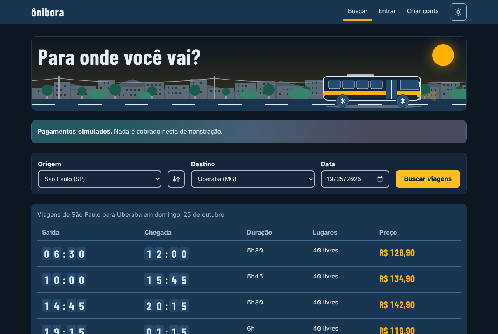 | 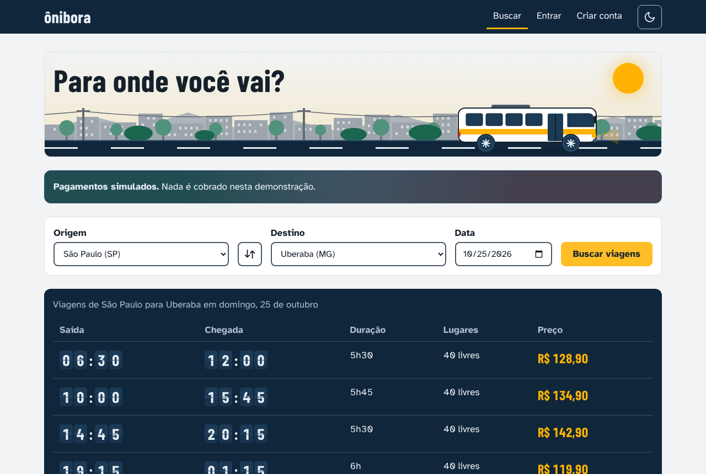 |
| 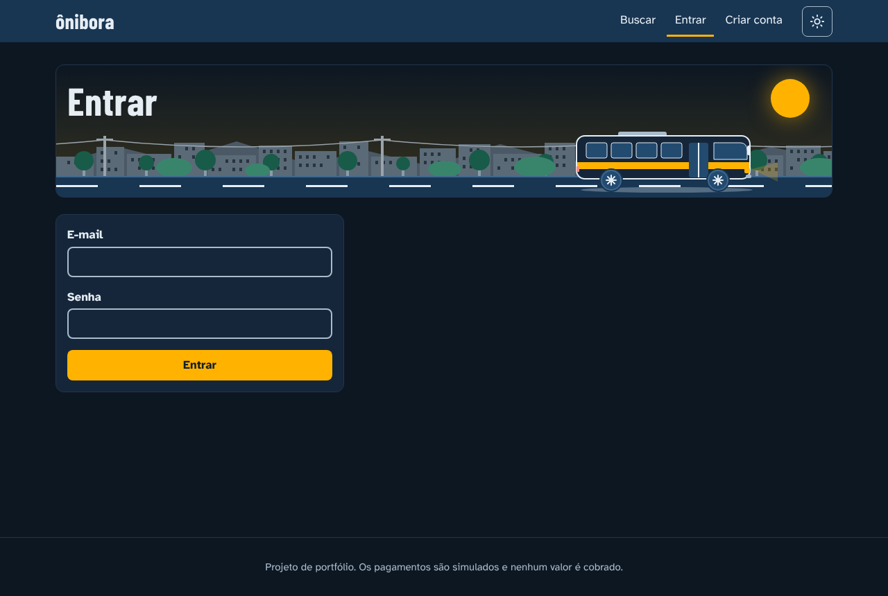 | 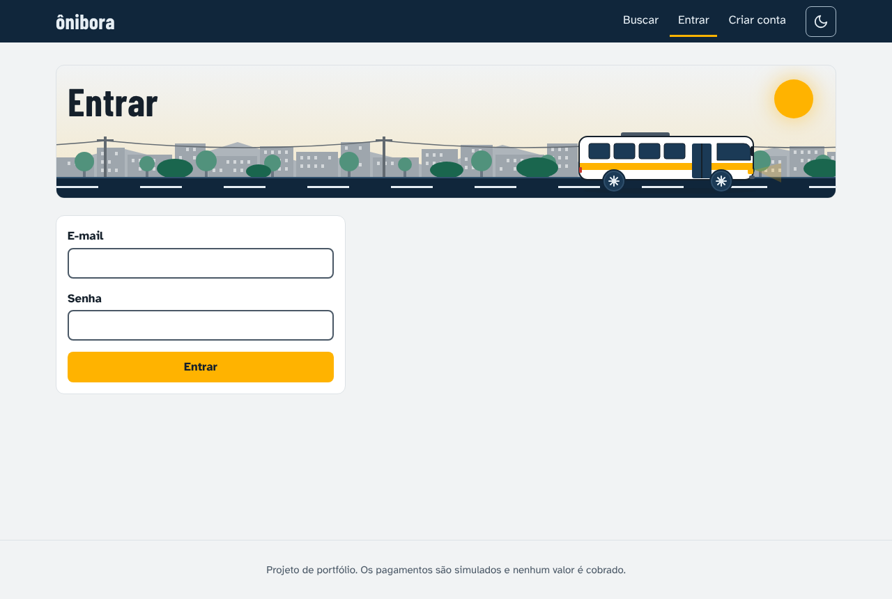 |
| 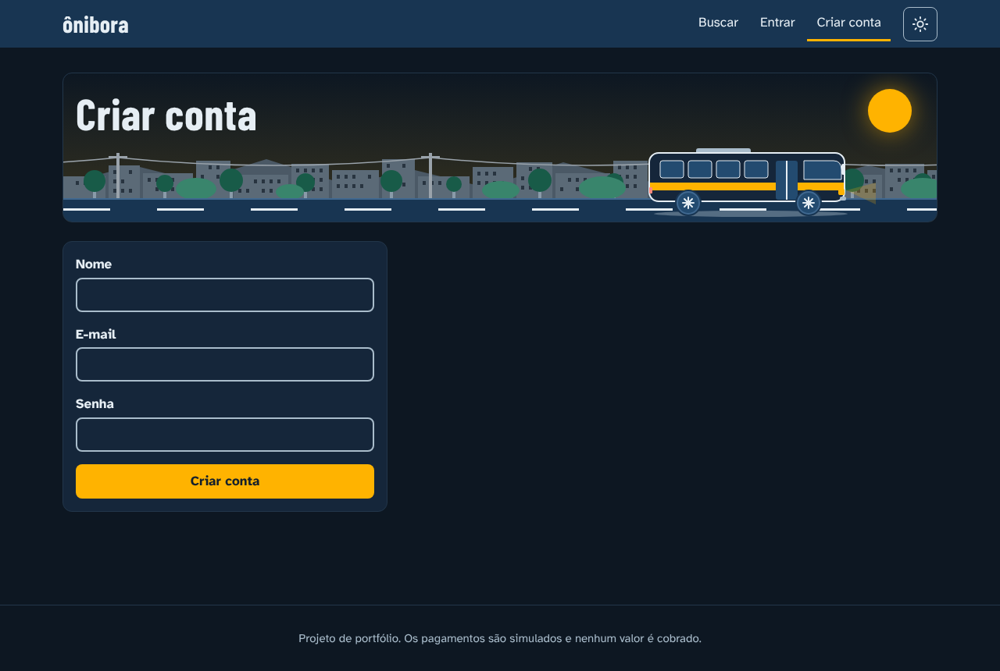 | 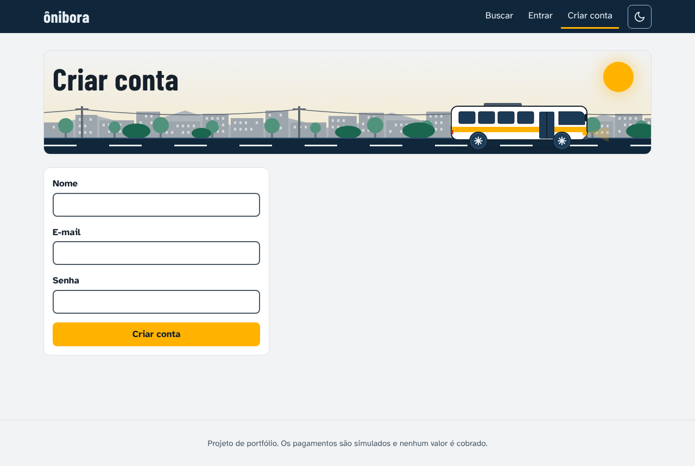 |
| 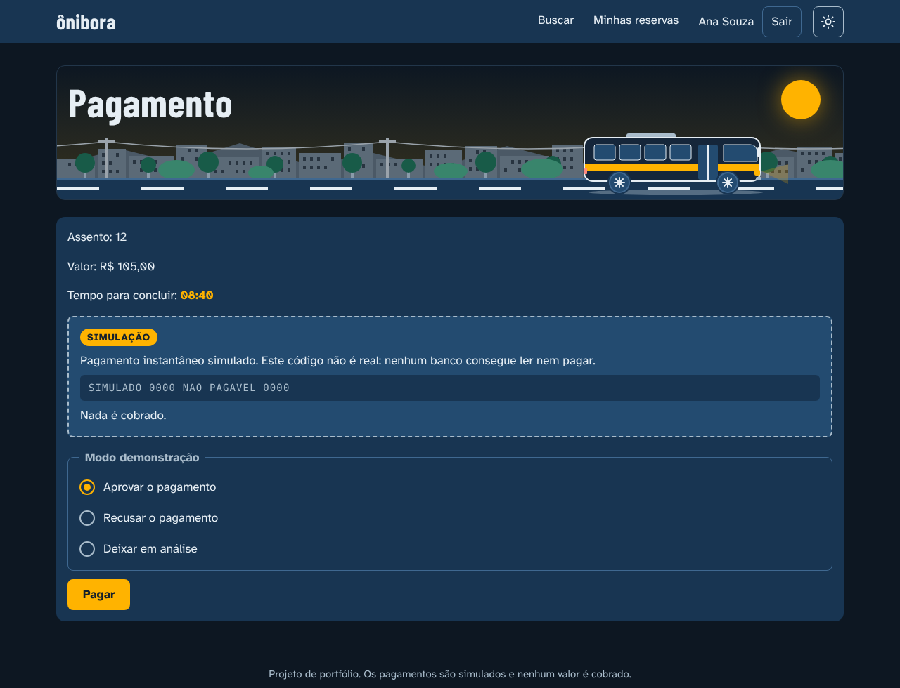 | 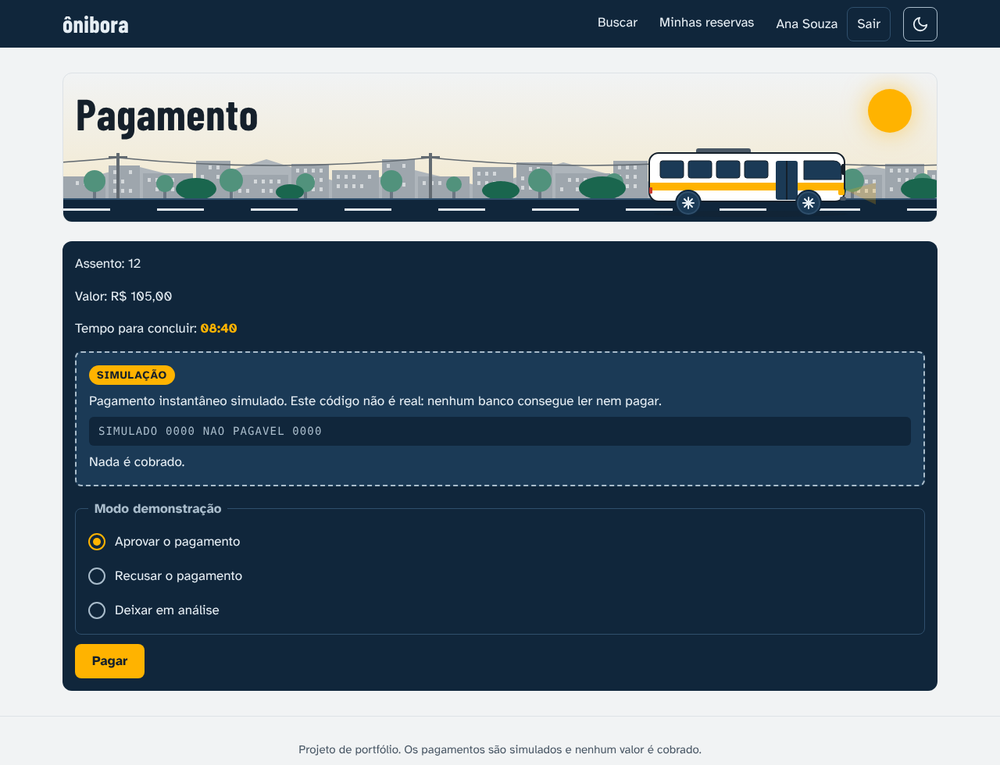 |
| 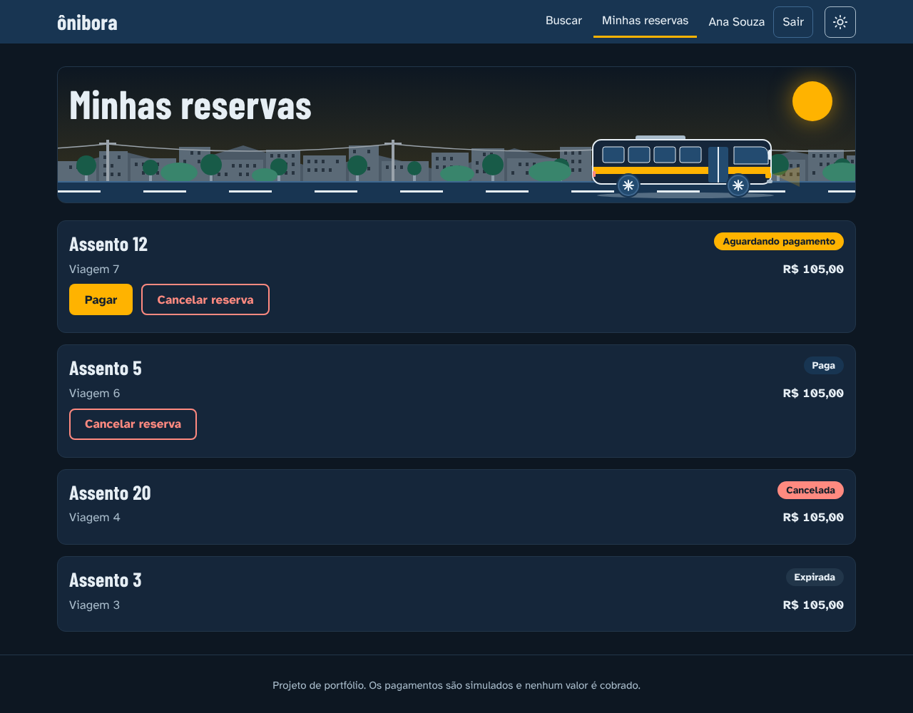 | 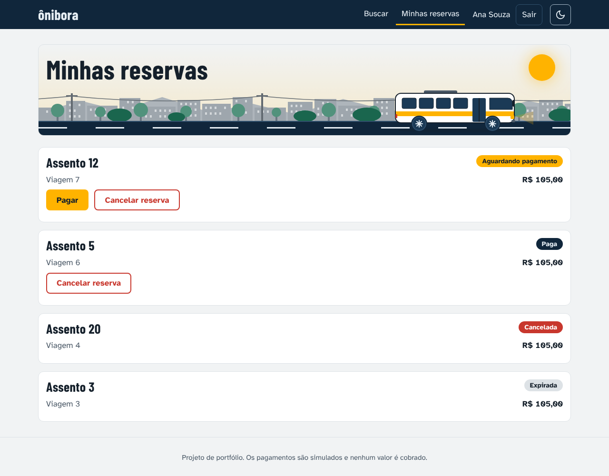 |

## What works today

- **Trip search** by origin, destination and date. The price of a trip is the sum of the per-leg prices between the two cities.
- **Accounts**: sign up (automatic sign-in afterwards), sign in, sign out, session restored on reload.
- **Authentication** with a short-lived access token and a rotating refresh token ([ADR 0003](docs/adr/0003-autenticacao-access-curto-e-refresh.md)).
- **Seat holds**: a signed-in passenger picks a seat on a seat grid and holds it for 10 minutes, with a countdown. Two people can never hold the same seat: PostgreSQL decides with `UNIQUE(trip_id, seat_number, leg_index)` and `INSERT ... ON CONFLICT` ([ADR 0004](docs/adr/0004-assento-unico-por-perna.md)). An expired hold frees the seat at once (lazy expiry), and a separate process cleans the old rows ([ADR 0005](docs/adr/0005-expirador-de-holds-em-processo-separado.md)).
- **Seat availability**: the trip page shows the free seats of each trip and a seat grid (free, held, taken).
- **Idempotent payment**: a held reservation is paid with `POST /api/reservations/{id}/pay` and an `Idempotency-Key` header. The same key sent twice, even at the same moment, makes **one** charge: the key lives in PostgreSQL (`PRIMARY KEY (user_id, key)`) and the payment gateway is called outside any transaction ([ADR 0007](docs/adr/0007-idempotencia-de-pagamento-no-postgresql.md)). The gateway is simulated and programmable (approve, decline or leave under review). Nothing is ever charged, and the checkout page marks the Pix code as a simulation.
- **Cancellation**: a held or paid reservation can be cancelled until the trip departs. The seat is freed at once and a paid reservation is fully refunded through the simulated gateway. Two simultaneous cancellations make **one** refund: the guarantee comes from the reservation state under a row lock, not from a key ([ADR 0008](docs/adr/0008-cancelamento-e-estornos.md)).
- **Reconciliation**: the worker asks the gateway about payments left `pending` (for example when the process died between the charge and the confirmation), delivers the seat or refunds the money, and retries refunds that failed during a cancellation ([ADR 0009](docs/adr/0009-reconciliacao-de-pagamentos.md)).
- **Reservations**: the hold survives a page reload, and the My reservations page lists each reservation with its status (awaiting payment, paid, cancelled, expired), a link to pay and a cancel button with an inline confirmation.
- **Front end** with a flap-style departure board, a route scene in the page header, a reduced-motion mode and keyboard and screen-reader support.
- **Seed script** that creates 4 cities, one route (São Paulo to Uberaba, with Campinas and Ribeirão Preto as stops) and 7 days of trips at 08:00 and 23:00, 40 seats each.

## Architecture

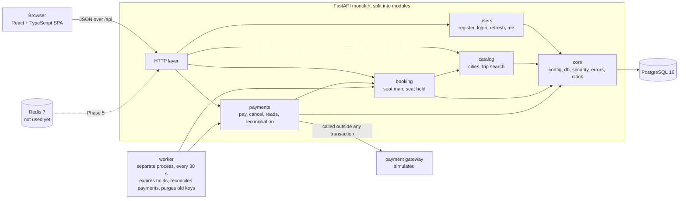

- A **modular monolith**: one deployable, with module boundaries that can be split later ([ADR 0001](docs/adr/0001-monolito-modular.md)).
- **PostgreSQL decides** every race. Registration and refresh-token rotation already rely on unique constraints and a single atomic `UPDATE`, not on checks in application code. Seat holds follow the same rule: the `UNIQUE` constraint rejects the loser of a race, and the code only translates that into a `409`. Payments follow it too: the idempotency-key row, the lock on the reservation and conditional updates such as `UPDATE ... WHERE status = 'pending'` decide, never an `if` in application code.
- **The gateway is never called inside a transaction.** Holding a lock while an outside service answers would block every other request on that row, so `pay` runs a short transaction A, then the gateway, then a short transaction B. If the process dies in between, the reconciliation in the worker settles the payment ([ADR 0007](docs/adr/0007-idempotencia-de-pagamento-no-postgresql.md), [ADR 0009](docs/adr/0009-reconciliacao-de-pagamentos.md)). The `PaymentGateway` interface is injected like the `Clock`, so tests program the gateway instead of sleeping.
- **Redis** is in the Compose file but unused until the real-time seat map (Phase 5).
- The front end lives in [`web/`](web/) ([ADR 0002](docs/adr/0002-front-react-typescript.md)).

### API

| Method | Path | Description |
| --- | --- | --- |
| GET | `/health` | Liveness check |
| GET | `/api/cities` | List cities |
| GET | `/api/trips?origin=<id>&destination=<id>&date=YYYY-MM-DD` | Search trips |
| GET | `/api/trips/availability?trip_ids=1&trip_ids=2` | Free seats per trip (up to 50 trips) |
| GET | `/api/trips/{id}/seats` | Seat map of a trip: each seat is `free`, `held` or `taken` |
| POST | `/api/trips/{id}/holds` | Hold a seat for 10 minutes (needs the access token). Body: `{ "seat_number": 7 }`. Returns `201` with `expires_at` and `expires_in_seconds`; `409` with `seat_unavailable` if someone else has the seat |
| GET | `/api/reservations` | Your reservations (up to 50, newest first) with the payment status. Needs the access token |
| GET | `/api/reservations/{id}` | One reservation, with `expires_in_seconds` while it is held. Someone else's reservation, or one that does not exist, is `404` |
| POST | `/api/reservations/{id}/pay` | Pays a held reservation (needs the access token and an `Idempotency-Key` header, `422` without it). Body: `{ "scenario": "approve" }` (or `decline`, `delay`). Returns `200` approved, `402` declined (the reservation stays held) or `202` under review. Errors: `409 reservation_not_payable`, `410 hold_expired` (nothing is charged), `422 idempotency_key_reused` (same key, different request), `409 request_in_progress`, `409 payment_already_resolved` (the reconciliation settled it first) and `409 seat_lost` (approved, but the seat had already gone to someone else, so it is refunded) |
| POST | `/api/reservations/{id}/cancel` | Cancels a held or paid reservation (needs the access token, no key). Returns `reservation_id`, `status` and `refund_status` (`none`, `pending` or `refunded`). `409` with `trip_already_departed`, `payment_in_progress` or `reservation_not_cancellable` |
| POST | `/api/auth/register` | Create an account |
| POST | `/api/auth/login` | Sign in; returns the access token and sets the refresh cookie |
| POST | `/api/auth/refresh` | Rotate the refresh token and return a new access token |
| POST | `/api/auth/logout` | Revoke the refresh token |
| GET | `/api/auth/me` | Current user (needs the access token) |

Interactive docs are served at `/docs` while the API is running. Domain errors use the shape `{ "code": "...", "message": "..." }`.

## Tech stack

- **Backend:** Python 3.12+, FastAPI, SQLAlchemy 2 (sync, psycopg 3), Alembic, Pydantic, argon2-cffi, PyJWT
- **Data:** PostgreSQL 16, Redis 7 (both through Docker Compose)
- **Front end:** React 19, TypeScript, Vite, React Router, GSAP, plain CSS with design tokens
- **Quality:** pytest, ruff, Vitest + Testing Library, ESLint, Prettier, GitHub Actions (jobs `ci` and `web`)

## Running it locally

**Requirements:** Python 3.12+, Node.js 24, Docker (with Compose).

```bash
git clone https://github.com/Prabovn7/bus-ticket-api.git
cd bus-ticket-api
```

**1. Configure the environment.** Copy the example file and edit it. The example `JWT_SECRET` is a short placeholder that the app rejects on purpose: use at least 32 random characters.

```bash
cp .env.example .env            # PowerShell: Copy-Item .env.example .env
python -c "import secrets; print(secrets.token_urlsafe(32))"   # paste the output as JWT_SECRET
```

Also change `POSTGRES_PASSWORD`. Never commit `.env`.

**2. Start PostgreSQL and Redis.**

```bash
docker compose up -d
```

**3. Install the backend, create the schema and load the catalog.**

```bash
python -m venv .venv
source .venv/bin/activate       # PowerShell: .venv\Scripts\Activate.ps1
pip install -r requirements-dev.txt

alembic upgrade head
python -m scripts.seed
```

The seed can be run more than once.

**4. Run the API** (http://127.0.0.1:8000, docs at `/docs`).

```bash
uvicorn app.main:app --reload
```

**4b. Run the worker** (optional, in another terminal with the virtualenv active). Seats are freed on time without it; it cleans up expired reservations, reconciles payments that were left pending and purges idempotency keys older than 24 hours.

```bash
python -m app.worker
```

**5. Run the front end**, in another terminal. The dev server proxies `/api` to the API on port 8000.

```bash
cd web
npm ci
npm run dev
```

Open the URL Vite prints (http://localhost:5173 by default), search São Paulo to Uberaba for today, create an account, open a trip, pick a seat, hold it and pay with the simulated Pix. The demo mode on the checkout page lets you approve, decline or leave the payment under review; the Minhas reservas page lists what you booked and cancels it.

### Tests and checks

```bash
# Backend (Docker must be running; the test database is created automatically)
pytest
ruff check .

# Front end, from web/
npm test
npm run lint
npm run format:check
npm run build
```

The same checks run in GitHub Actions on every pull request.

## Roadmap

| Phase | Scope | Status |
| --- | --- | --- |
| 1 | Project structure, Compose, catalog with seed, trip search, accounts with JWT, CI, front end for search, sign up and sign in | Done (`v0.1.0`) |
| 2 | 10-minute seat hold on the full trip. Started with a naive version, showed the 100-request test failing, then fixed it with `UNIQUE(trip_id, seat_number, leg_index)` and `INSERT ... ON CONFLICT`; lazy and active expiry; seat grid and hold countdown in the front end | Done (`v0.2.0`) |
| 3 | Idempotent payment (`Idempotency-Key`) in PostgreSQL with a simulated gateway called outside any transaction, cancellation with a refund, reconciliation of payments left pending, checkout and My reservations in the front end | Done (`v0.3.0`) |
| 4 | Reservation by leg (A to B to C to D), per-leg pricing, overlap tests | Next |
| 5 | Real-time seat map (SSE + Redis pub/sub) | Planned |
| 6 | Deploy with CI/CD, Dockerfile and `api` service in Compose, Locust results | Planned |

The key test of the project: **100 simultaneous requests for the same seat and leg, exactly one succeeds.** Phase 3 adds two more: **the same `Idempotency-Key` sent at the same moment makes one charge**, and **two simultaneous cancellations make one refund**.

## Limitations and next steps

Known gaps in this version, kept here on purpose. Each one is either planned or a conscious trade-off.

**Authentication and security**

- The access token cannot be revoked before it expires (15 minutes). Signing out revokes the refresh token only.
- There is no rate limit on login yet. It is planned for Phase 6, together with Redis.
- There is no absolute session cap: the 24-hour refresh window slides on every use.
- The `refresh_tokens` table is never cleaned up.
- Two browser tabs renewing the session at the same moment can revoke the whole token family. The single in-flight renewal is per tab; `navigator.locks` or a `BroadcastChannel` would fix it.
- Signing up with an existing e-mail returns `409`, which reveals that the account exists. Accepted for now.
- `COOKIE_SECURE` defaults to `true`. `.env.example` sets it to `false` only for local development over plain HTTP; keep it `true` behind HTTPS.
- A single `JWT_SECRET` signs every token.
- Security headers and a Content-Security-Policy are missing, and the theme script in `index.html` will need a hash in that policy. All of this belongs to the pre-deploy checklist.

**Data**

- The rule that only the last stop of a route may have a null price is enforced by the seed and the service code, not by the schema, and the search `SUM` ignores nulls. To be fixed in Phase 4.
- The seed creates missing data but does not update existing rows.
- `trips` has no `UNIQUE(route_id, departure_at)`.
- The date filter of the search does not use an index.
- The search does not show intermediate stops or per-leg prices until Phase 4.

**Seat holds**

- A reservation is one seat. Buying several seats in one purchase is not supported yet.
- A hold covers the whole trip only. Partial legs (A to B, B to C) come in Phase 4; the schema already has `leg_index` for it.
- The seat map is read on page load and after a conflict. It does not update by itself until the real-time map (Phase 5).
- The countdown ignores network latency. The server decides: a late request fails even if the screen still shows a second left ([ADR 0006](docs/adr/0006-contador-do-hold-com-relogio-monotonico.md)).
- The seat chosen before signing in is not remembered across the sign-in page. After signing in the passenger returns to the trip page, but sign-up still goes to the home page.
- When the session cannot be renewed, the header keeps showing the user as signed in until the page is reloaded.
- Cancelling the request in the browser does not undo a hold the server already created.
- There is no cap on how many seats one account can hold and no rate limit on `/holds`, so a single account can hold a whole bus for 10 minutes, repeatedly. A per-user cap and a rate limit are not implemented yet.

**Payments and reservations**

- The gateway is simulated. Nothing is ever charged, and the Pix code is a fixed text marked "Simulation", not a valid BR Code. A real gateway would be plugged in behind the `PaymentGateway` interface.
- In demo mode the client chooses the outcome (`scenario` in the request body: `approve`, `decline` or `delay`). It exists to show the failure paths and must not exist in a real deployment.
- There is no gateway webhook. The reconciliation asks the gateway about payments that have been `pending` for at least 45 seconds, once per worker round (30 seconds), so a payment left under review can wait a minute or so.
- The worker is one process with three jobs (expire holds, reconcile payments, purge idempotency keys). Several can run at once (`FOR UPDATE SKIP LOCKED`), but nothing supervises them until Phase 6. Without a worker, holds are still freed on time, but pending payments and failed refunds wait ([ADR 0009](docs/adr/0009-reconciliacao-de-pagamentos.md)).
- A refund is always full, with no fee and no deadline rule, and a reservation can be cancelled only until the trip departs. If the gateway fails during a cancellation, the seat is freed anyway and the refund waits for the reconciliation: the accepted worst case is "seat free, refund late", never "money returned with the seat still taken" ([ADR 0008](docs/adr/0008-cancelamento-e-estornos.md)).
- Idempotency keys are kept for 24 hours and then purged. A retry after that is a new request; the reservation state still prevents a second charge on one that is already paid (`reservation_not_payable`).
- The client creates one key per payment attempt with `crypto.randomUUID()` and reuses it on a retry. That function exists only in secure contexts (HTTPS or `localhost`).
- There is no rate limit on `/pay` or `/cancel`, and no account deletion yet. Both are planned for Phase 6, which also has to decide what happens to paid reservations when an account is deleted.

**Front end**

- The Vite proxy exists only in development. Serving the SPA and the API from the same origin is part of Phase 6.
- There is no visual regression testing: how the departure board looks is checked by hand. Color contrast of the main tokens is covered by unit tests.
- GSAP is part of the main bundle (about 28 kB gzipped) and could be loaded only where it is needed. Its license is not MIT: see [ADR 0002](docs/adr/0002-front-react-typescript.md).
- There is no exit animation between pages.
- The sign-in and sign-up pages do not redirect people who are already signed in.
- The API client trusts the response types (`as T`) and does no runtime validation.
- My reservations shows the trip by its number only: the reservation response has no city names or times yet.
- When a cancellation fails (for example `409` because the trip already left), the row shows the message but the list is not reloaded, so a change made elsewhere shows up only after a reload.
- After a successful cancellation, keyboard focus is not moved: the button that had it disappears.
- If one account holds two seats on the same trip, only the most recent hold is resumed after a reload.

**Infrastructure**

- Compose publishes PostgreSQL and Redis on `127.0.0.1` only, so `.env.example` uses `127.0.0.1` instead of `localhost` (on Windows, `localhost` can resolve to IPv6 first and every new connection waits for a timeout). Redis still has no password (planned for Phase 5), and the images are pinned only by major version.
- The database `engine` is created at import time, and foreign keys have no explicit names.
- GitHub Actions are pinned by tag, not by hash. `pip-audit` and `npm audit` are not in the pipeline.

## Architecture decisions

- [ADR 0001: modular monolith](docs/adr/0001-monolito-modular.md)
- [ADR 0002: React and TypeScript front end](docs/adr/0002-front-react-typescript.md)
- [ADR 0003: short access token and rotating refresh token](docs/adr/0003-autenticacao-access-curto-e-refresh.md)
- [ADR 0004: one seat per leg, enforced by the database with UNIQUE and ON CONFLICT](docs/adr/0004-assento-unico-por-perna.md)
- [ADR 0005: the hold expirer runs as a separate process](docs/adr/0005-expirador-de-holds-em-processo-separado.md)
- [ADR 0006: the hold countdown uses server seconds and a monotonic clock](docs/adr/0006-contador-do-hold-com-relogio-monotonico.md)
- [ADR 0007: payment idempotency in PostgreSQL, with the gateway outside the transaction](docs/adr/0007-idempotencia-de-pagamento-no-postgresql.md)
- [ADR 0008: idempotent cancellation by reservation state, with the refund outside the transaction](docs/adr/0008-cancelamento-e-estornos.md)
- [ADR 0009: payment reconciliation in the worker process](docs/adr/0009-reconciliacao-de-pagamentos.md)

The ADRs are written in Portuguese.

## License

MIT. See [LICENSE](LICENSE).
