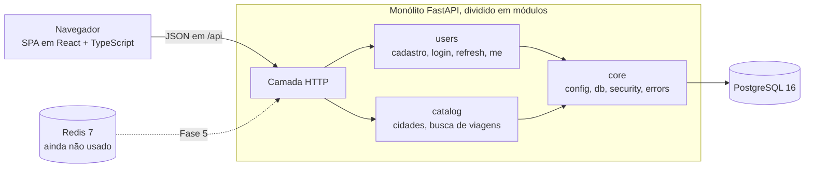

# bus-ticket-api

Venda de passagens de ônibus intermunicipais, feita como projeto de portfólio com um objetivo: **dois passageiros nunca podem comprar o mesmo assento no mesmo trecho de uma viagem.** O backend é onde estão os problemas interessantes (concorrência, consistência, idempotência); o front-end em React existe para torná-los visíveis.

English: [README.md](README.md)

> **Status:** Fase 1 de 6 (`v0.1.0`). Catálogo, busca de viagens, contas com login JWT e front-end em React estão prontos. Reserva temporária de assento, pagamentos e mapa de assentos em tempo real vêm nas próximas fases. Veja o [roadmap](#roadmap).

## Capturas de tela

O front-end se chama **Ônibora**. Ele segue o tema do sistema e tem um botão para trocar manualmente. As telas abaixo foram geradas com uma API simulada e dados fictícios.

| Escuro | Claro |
| --- | --- |
|  |  |
|  |  |
|  |  |

## O que funciona hoje

- **Busca de viagens** por origem, destino e data. O preço de uma viagem é a soma dos preços de cada trecho entre as duas cidades.
- **Contas**: cadastro (com login automático em seguida), entrar, sair e sessão restaurada ao recarregar a página.
- **Autenticação** com access token de vida curta e refresh token rotativo ([ADR 0003](docs/adr/0003-autenticacao-access-curto-e-refresh.md)).
- **Front-end** com um quadro de horários em estilo de placa de aeroporto, uma cena de estrada no topo das páginas, modo de movimento reduzido e suporte a teclado e leitor de tela.
- **Script de seed** que cria 4 cidades, uma rota (São Paulo a Uberaba, com Campinas e Ribeirão Preto como paradas) e 7 dias de viagens às 08:00 e às 23:00, com 40 assentos cada.

## Arquitetura



- Um **monólito modular**: um único artefato de deploy, com fronteiras entre módulos que podem ser separadas depois ([ADR 0001](docs/adr/0001-monolito-modular.md)).
- **O PostgreSQL decide** cada disputa. O cadastro e a rotação do refresh token já dependem de restrições de unicidade e de um único `UPDATE` atômico, não de checagens no código da aplicação. A reserva de assentos seguirá a mesma regra.
- O **Redis** está no Compose, mas não é usado até o mapa de assentos em tempo real (Fase 5).
- O front-end fica em [`web/`](web/) ([ADR 0002](docs/adr/0002-front-react-typescript.md)).

### API

| Método | Caminho | Descrição |
| --- | --- | --- |
| GET | `/health` | Verificação de funcionamento |
| GET | `/api/cities` | Lista as cidades |
| GET | `/api/trips?origin=<id>&destination=<id>&date=AAAA-MM-DD` | Busca viagens |
| POST | `/api/auth/register` | Cria uma conta |
| POST | `/api/auth/login` | Entra; devolve o access token e grava o cookie do refresh token |
| POST | `/api/auth/refresh` | Rotaciona o refresh token e devolve um novo access token |
| POST | `/api/auth/logout` | Revoga o refresh token |
| GET | `/api/auth/me` | Usuário atual (exige o access token) |

A documentação interativa fica em `/docs` com a API rodando. Os erros de domínio têm o formato `{ "code": "...", "message": "..." }`.

## Stack

- **Backend:** Python 3.12+, FastAPI, SQLAlchemy 2 (síncrono, psycopg 3), Alembic, Pydantic, argon2-cffi, PyJWT
- **Dados:** PostgreSQL 16, Redis 7 (ambos pelo Docker Compose)
- **Front-end:** React 19, TypeScript, Vite, React Router, GSAP, CSS puro com tokens de design
- **Qualidade:** pytest, ruff, Vitest + Testing Library, ESLint, Prettier, GitHub Actions (jobs `ci` e `web`)

## Rodando localmente

**Requisitos:** Python 3.12+, Node.js 24, Docker (com Compose).

```bash
git clone https://github.com/Prabovn7/bus-ticket-api.git
cd bus-ticket-api
```

**1. Configure o ambiente.** Copie o arquivo de exemplo e edite. O `JWT_SECRET` do exemplo é um valor curto que o app rejeita de propósito: use pelo menos 32 caracteres aleatórios.

```bash
cp .env.example .env            # PowerShell: Copy-Item .env.example .env
python -c "import secrets; print(secrets.token_urlsafe(32))"   # cole o resultado em JWT_SECRET
```

Troque também o `POSTGRES_PASSWORD`. Nunca faça commit do `.env`.

**2. Suba o PostgreSQL e o Redis.**

```bash
docker compose up -d
```

**3. Instale o backend, crie o esquema e carregue o catálogo.**

```bash
python -m venv .venv
source .venv/bin/activate       # PowerShell: .venv\Scripts\Activate.ps1
pip install -r requirements-dev.txt

alembic upgrade head
python -m scripts.seed
```

O seed pode ser executado mais de uma vez.

**4. Rode a API** (http://127.0.0.1:8000, documentação em `/docs`).

```bash
uvicorn app.main:app --reload
```

**5. Rode o front-end**, em outro terminal. O servidor de desenvolvimento encaminha `/api` para a API na porta 8000.

```bash
cd web
npm ci
npm run dev
```

Abra o endereço que o Vite mostrar (http://localhost:5173 por padrão), busque São Paulo a Uberaba para hoje e depois crie uma conta.

### Testes e verificações

```bash
# Backend (o Docker precisa estar rodando; o banco de testes é criado automaticamente)
pytest
ruff check .

# Front-end, a partir de web/
npm test
npm run lint
npm run format:check
npm run build
```

As mesmas verificações rodam no GitHub Actions a cada pull request.

## Roadmap

| Fase | Escopo | Status |
| --- | --- | --- |
| 1 | Estrutura do projeto, Compose, catálogo com seed, busca de viagens, contas com JWT, CI, front-end de busca, cadastro e login | Concluída (`v0.1.0`) |
| 2 | Reserva temporária de assento (10 min) no trecho completo. Começa pela versão ingênua, mostra o teste de 100 requisições falhando e corrige com `UNIQUE(trip_id, seat_number, leg_index)` e `INSERT ... ON CONFLICT`; expiração preguiçosa e ativa | Próxima |
| 3 | Pagamento idempotente (`Idempotency-Key`) com gateway simulado, reconciliação e cancelamento | Planejada |
| 4 | Reserva por trecho (A para B para C para D), preço por perna, testes de sobreposição | Planejada |
| 5 | Mapa de assentos em tempo real (SSE + Redis pub/sub) | Planejada |
| 6 | Deploy com CI/CD, Dockerfile e serviço `api` no Compose, resultados do Locust | Planejada |

O teste-chave do projeto: **100 requisições simultâneas para o mesmo assento e trecho, exatamente 1 sucesso.**

## Limitações e próximos passos

Lacunas conhecidas desta versão, registradas aqui de propósito. Cada uma está planejada ou é uma troca consciente.

**Autenticação e segurança**

- O access token não pode ser revogado antes de expirar (15 minutos). Sair revoga apenas o refresh token.
- Ainda não há limite de tentativas no login. Está planejado para a Fase 6, junto com o Redis.
- Não há teto absoluto de sessão: a janela de 24 horas do refresh token se renova a cada uso.
- A tabela `refresh_tokens` nunca é limpa.
- Duas abas do navegador renovando a sessão ao mesmo tempo podem revogar a família inteira de tokens. A renovação única em andamento vale por aba; `navigator.locks` ou um `BroadcastChannel` resolveria.
- Cadastrar com um e-mail que já existe devolve `409`, o que revela que a conta existe. Aceito por enquanto.
- `COOKIE_SECURE` vem como `false` por padrão, para o desenvolvimento local. O padrão mudará para `true` no início da Fase 2.
- Um único `JWT_SECRET` assina todos os tokens.
- Faltam cabeçalhos de segurança e uma Content-Security-Policy, e o script do tema no `index.html` vai precisar de um hash nessa política. Tudo isso pertence ao checklist de pré-deploy.

**Dados**

- A regra de que só a última parada de uma rota pode ter preço nulo é garantida pelo seed e pelo código do serviço, não pelo esquema, e o `SUM` da busca ignora valores nulos. Será corrigido na Fase 4.
- O seed cria o que falta, mas não atualiza linhas existentes.
- `trips` não tem `UNIQUE(route_id, departure_at)`.
- O filtro de data da busca não usa índice.
- A busca não mostra paradas intermediárias nem preços por trecho até a Fase 4.

**Front-end**

- O proxy do Vite existe só em desenvolvimento. Servir o SPA e a API na mesma origem faz parte da Fase 6.
- Não há teste de regressão visual: a aparência do quadro de horários é conferida à mão. O contraste de cor dos tokens principais é coberto por testes unitários.
- O GSAP faz parte do bundle principal (cerca de 28 kB comprimido) e poderia ser carregado só onde é necessário. A licença dele não é MIT: veja o [ADR 0002](docs/adr/0002-front-react-typescript.md).
- Não há animação de saída entre páginas.
- As páginas Entrar e Criar conta não redirecionam quem já está autenticado.
- O cliente da API confia nos tipos da resposta (`as T`) e não valida nada em tempo de execução.

**Infraestrutura**

- O Compose publica o PostgreSQL e o Redis em todas as interfaces de rede, o Redis não tem senha e as imagens estão fixadas apenas pela versão principal. As portas passarão a escutar só em `127.0.0.1` no início da Fase 2.
- O `engine` do banco é criado no momento do import, e as chaves estrangeiras não têm nomes explícitos.
- As Actions do GitHub estão fixadas por tag, não por hash. `pip-audit` e `npm audit` não fazem parte do pipeline.

## Decisões de arquitetura

- [ADR 0001: monólito modular](docs/adr/0001-monolito-modular.md)
- [ADR 0002: front-end em React e TypeScript](docs/adr/0002-front-react-typescript.md)
- [ADR 0003: access token curto e refresh token rotativo](docs/adr/0003-autenticacao-access-curto-e-refresh.md)

## Licença

MIT. Veja o [LICENSE](LICENSE).
