<p align="center">
  <picture>
    <source media="(prefers-color-scheme: dark)" srcset="docs/img/logo-dark.svg">
    
  </picture>
</p>

# bus-ticket-api

Venda de passagens de ônibus intermunicipais, feita como projeto de portfólio com um objetivo: **dois passageiros nunca podem comprar o mesmo assento no mesmo trecho de uma viagem.** O backend é onde estão os problemas interessantes (concorrência, consistência, idempotência); o front-end em React existe para torná-los visíveis.

English: [README.md](README.md)

> **Status:** Fase 3 de 6 (`v0.3.0`). Catálogo, busca de viagens, contas com login JWT, front-end em React, reserva temporária de assento (10 minutos), pagamento simulado e idempotente com cancelamento e reconciliação, página de checkout e página Minhas reservas estão prontos. Reserva por trecho e mapa de assentos em tempo real vêm nas próximas fases. Veja o [roadmap](#roadmap).

## Capturas de tela

O front-end se chama **Ônibora**. Ele segue o tema do sistema e tem um botão para trocar manualmente. As telas abaixo foram geradas com uma API simulada e dados fictícios.

| Escuro | Claro |
| --- | --- |
| 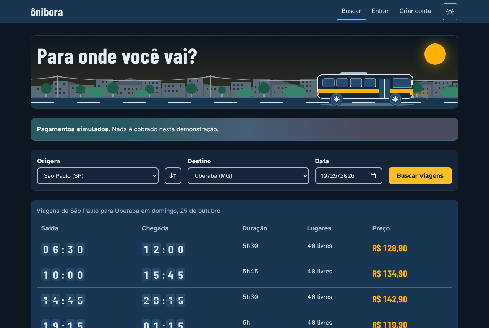 | 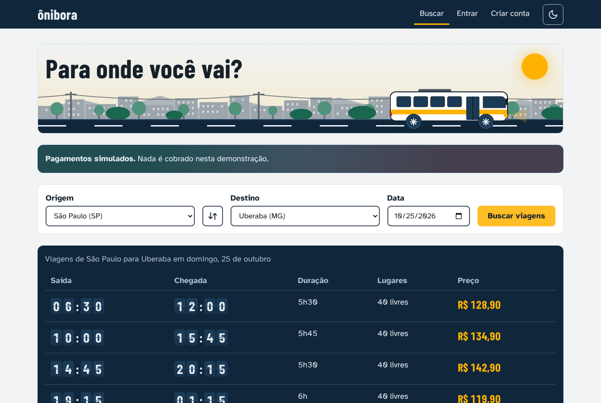 |
| 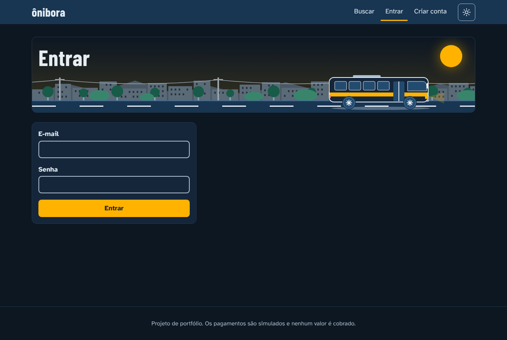 | 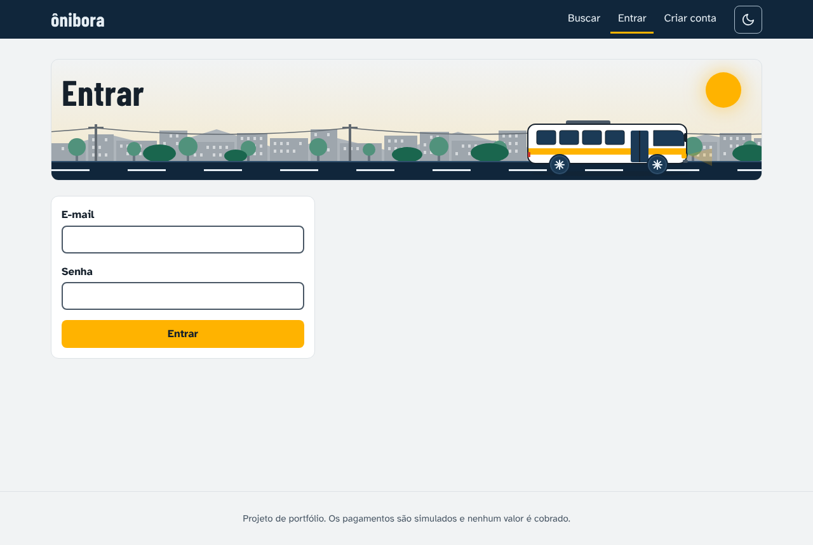 |
| 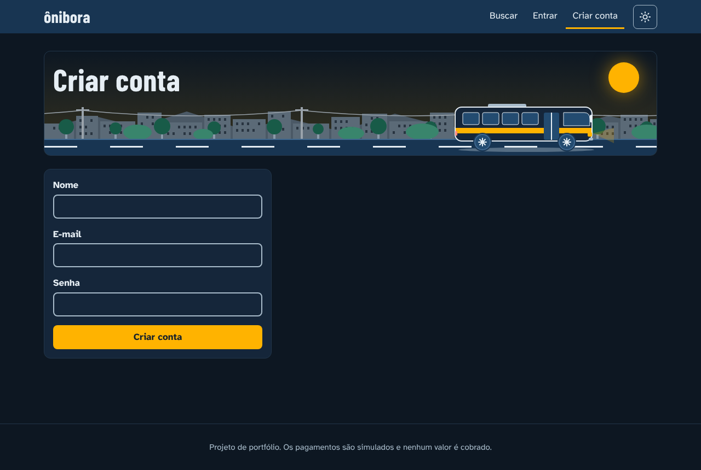 | 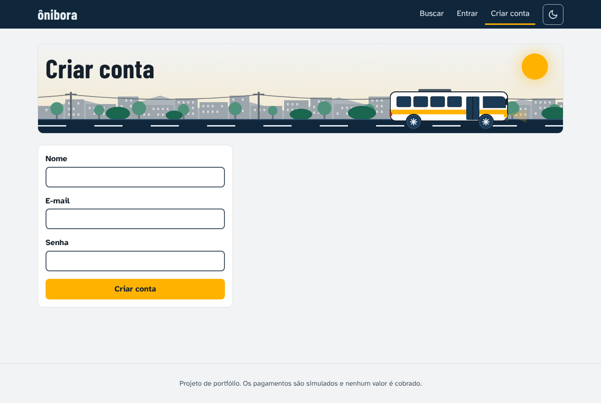 |
| 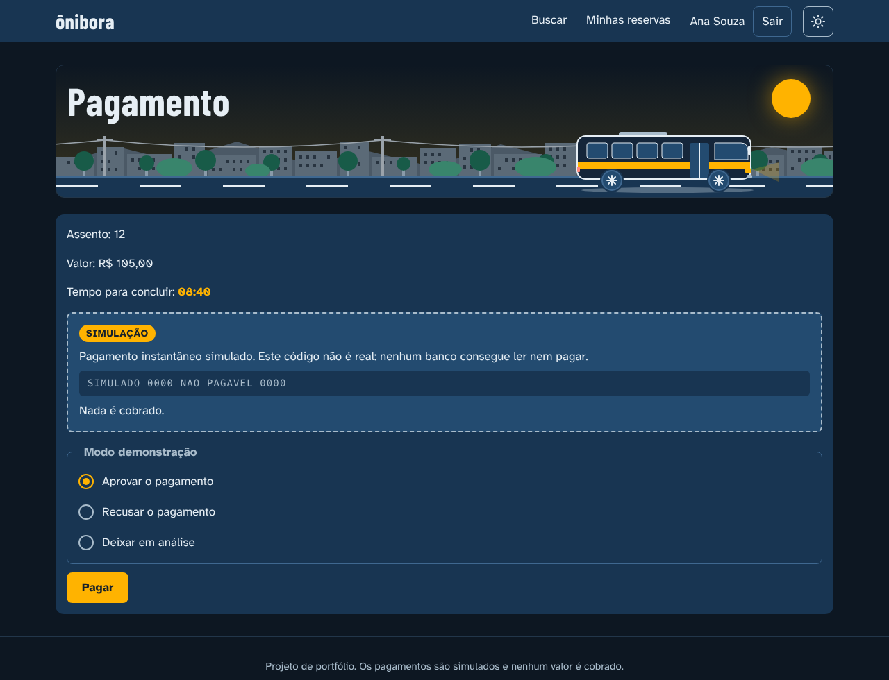 | 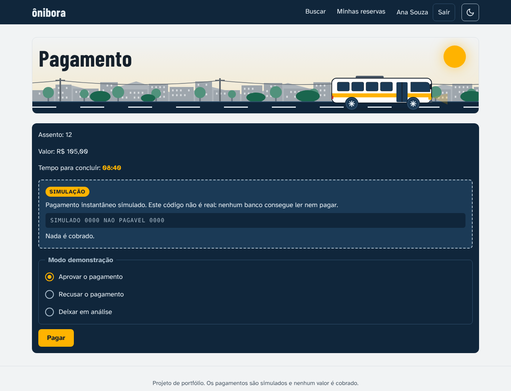 |
| 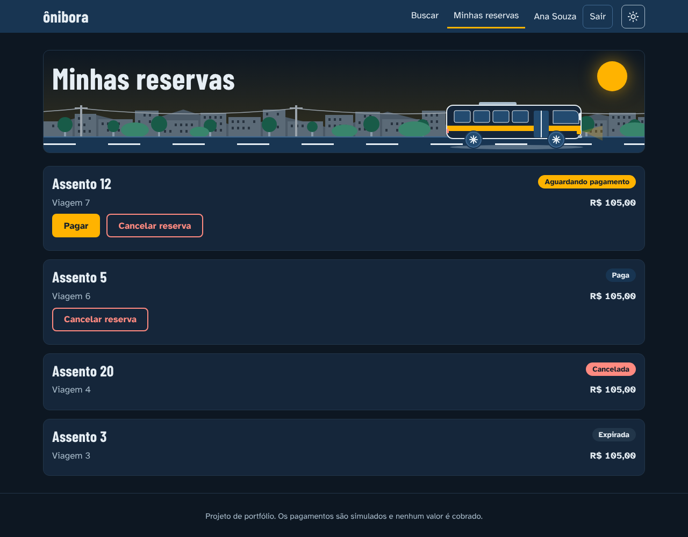 | 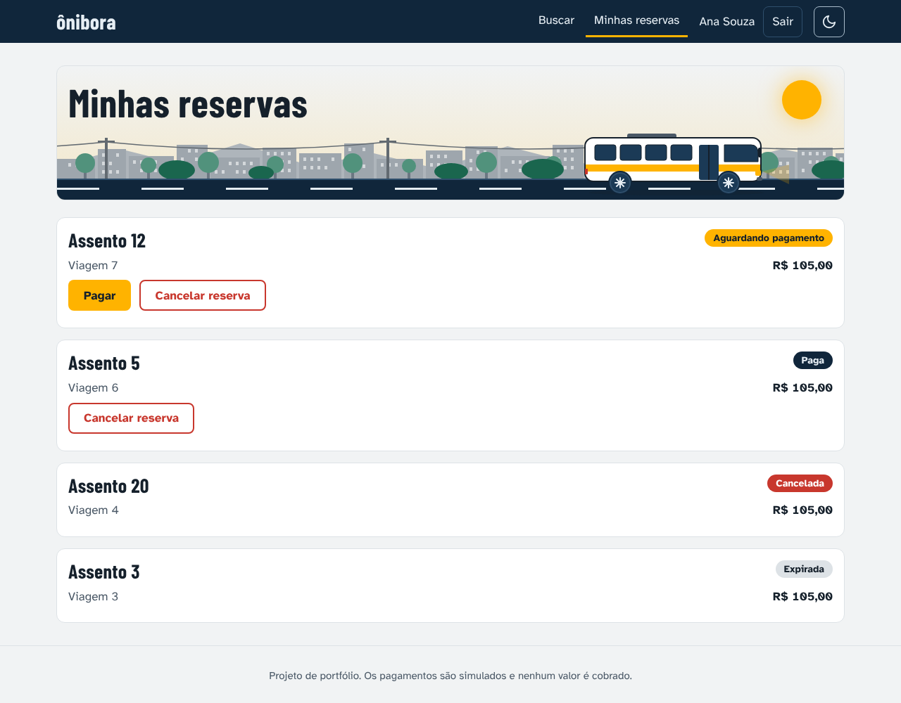 |

## O que funciona hoje

- **Busca de viagens** por origem, destino e data. O preço de uma viagem é a soma dos preços de cada trecho entre as duas cidades.
- **Contas**: cadastro (com login automático em seguida), entrar, sair e sessão restaurada ao recarregar a página.
- **Autenticação** com access token de vida curta e refresh token rotativo ([ADR 0003](docs/adr/0003-autenticacao-access-curto-e-refresh.md)).
- **Reserva temporária de assento (hold)**: o passageiro autenticado escolhe um assento na grade e o segura por 10 minutos, com contagem regressiva. Duas pessoas nunca seguram o mesmo assento: o PostgreSQL decide com `UNIQUE(trip_id, seat_number, leg_index)` e `INSERT ... ON CONFLICT` ([ADR 0004](docs/adr/0004-assento-unico-por-perna.md)). Um hold vencido libera o assento na hora (expiração preguiçosa), e um processo separado limpa as reservas antigas ([ADR 0005](docs/adr/0005-expirador-de-holds-em-processo-separado.md)).
- **Disponibilidade de assentos**: a página da viagem mostra os assentos livres de cada viagem e uma grade de assentos (livre, segurado, ocupado).
- **Pagamento idempotente**: uma reserva segura é paga com `POST /api/reservations/{id}/pay` e o cabeçalho `Idempotency-Key`. A mesma chave enviada duas vezes, até ao mesmo tempo, gera **uma** cobrança: a chave fica no PostgreSQL (`PRIMARY KEY (user_id, key)`) e o gateway de pagamento é chamado fora de qualquer transação ([ADR 0007](docs/adr/0007-idempotencia-de-pagamento-no-postgresql.md)). O gateway é simulado e programável (aprova, recusa ou deixa em análise). Nada é cobrado de verdade, e a página de checkout marca o código Pix como simulação.
- **Cancelamento**: uma reserva segura ou paga pode ser cancelada até a partida da viagem. O assento é liberado na hora e uma reserva paga é estornada por inteiro pelo gateway simulado. Dois cancelamentos simultâneos geram **um** estorno: a garantia vem do estado da reserva sob um lock de linha, não de uma chave ([ADR 0008](docs/adr/0008-cancelamento-e-estornos.md)).
- **Reconciliação**: o worker consulta o gateway sobre pagamentos que ficaram `pending` (por exemplo, quando o processo caiu entre a cobrança e a confirmação), entrega o assento ou devolve o dinheiro, e repete estornos que falharam durante um cancelamento ([ADR 0009](docs/adr/0009-reconciliacao-de-pagamentos.md)).
- **Reservas**: o hold sobrevive a recarregar a página, e a página Minhas reservas lista cada reserva com o estado (aguardando pagamento, paga, cancelada, expirada), um link para pagar e um botão de cancelar com confirmação na própria linha.
- **Front-end** com um quadro de horários em estilo de placa de aeroporto, uma cena de estrada no topo das páginas, modo de movimento reduzido e suporte a teclado e leitor de tela.
- **Script de seed** que cria 4 cidades, uma rota (São Paulo a Uberaba, com Campinas e Ribeirão Preto como paradas) e 7 dias de viagens às 08:00 e às 23:00, com 40 assentos cada.

## Arquitetura

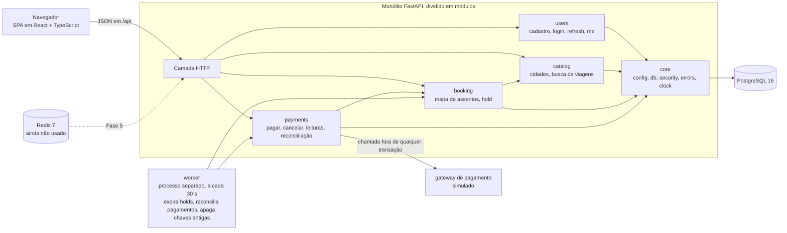

- Um **monólito modular**: um único artefato de deploy, com fronteiras entre módulos que podem ser separadas depois ([ADR 0001](docs/adr/0001-monolito-modular.md)).
- **O PostgreSQL decide** cada disputa. O cadastro e a rotação do refresh token já dependem de restrições de unicidade e de um único `UPDATE` atômico, não de checagens no código da aplicação. O hold de assento segue a mesma regra: a restrição `UNIQUE` rejeita quem perde a disputa, e o código só traduz isso em um `409`. O pagamento também: a linha da chave de idempotência, o lock na reserva e atualizações condicionais como `UPDATE ... WHERE status = 'pending'` decidem, nunca um `if` no código da aplicação.
- **O gateway nunca é chamado dentro de uma transação.** Segurar um lock enquanto um serviço externo responde bloquearia qualquer outra requisição sobre aquela linha, então o `pay` faz uma transação A curta, depois o gateway, depois uma transação B curta. Se o processo cair no meio, a reconciliação do worker resolve o pagamento ([ADR 0007](docs/adr/0007-idempotencia-de-pagamento-no-postgresql.md), [ADR 0009](docs/adr/0009-reconciliacao-de-pagamentos.md)). A interface `PaymentGateway` é injetada como o `Clock`, então os testes programam o gateway em vez de esperar.
- O **Redis** está no Compose, mas não é usado até o mapa de assentos em tempo real (Fase 5).
- O front-end fica em [`web/`](web/) ([ADR 0002](docs/adr/0002-front-react-typescript.md)).

### API

| Método | Caminho | Descrição |
| --- | --- | --- |
| GET | `/health` | Verificação de funcionamento |
| GET | `/api/cities` | Lista as cidades |
| GET | `/api/trips?origin=<id>&destination=<id>&date=AAAA-MM-DD` | Busca viagens |
| GET | `/api/trips/availability?trip_ids=1&trip_ids=2` | Assentos livres por viagem (até 50 viagens) |
| GET | `/api/trips/{id}/seats` | Mapa de assentos da viagem: cada assento é `free`, `held` ou `taken` |
| POST | `/api/trips/{id}/holds` | Segura um assento por 10 minutos (exige o access token). Corpo: `{ "seat_number": 7 }`. Devolve `201` com `expires_at` e `expires_in_seconds`; `409` com `seat_unavailable` se outra pessoa já tem o assento |
| GET | `/api/reservations` | Suas reservas (até 50, as mais novas primeiro), com o estado do pagamento. Exige o access token |
| GET | `/api/reservations/{id}` | Uma reserva, com `expires_in_seconds` enquanto estiver segura. Reserva de outra pessoa, ou que não existe, dá `404` |
| POST | `/api/reservations/{id}/pay` | Paga uma reserva segura (exige o access token e o cabeçalho `Idempotency-Key`, `422` sem ele). Corpo: `{ "scenario": "approve" }` (ou `decline`, `delay`). Devolve `200` aprovado, `402` recusado (a reserva continua segura) ou `202` em análise. Erros: `409 reservation_not_payable`, `410 hold_expired` (nada é cobrado), `422 idempotency_key_reused` (mesma chave, pedido diferente), `409 request_in_progress`, `409 payment_already_resolved` (a reconciliação resolveu antes) e `409 seat_lost` (aprovado, mas o assento já era de outra pessoa, então é estornado) |
| POST | `/api/reservations/{id}/cancel` | Cancela uma reserva segura ou paga (exige o access token, sem chave). Devolve `reservation_id`, `status` e `refund_status` (`none`, `pending` ou `refunded`). `409` com `trip_already_departed`, `payment_in_progress` ou `reservation_not_cancellable` |
| POST | `/api/auth/register` | Cria uma conta |
| POST | `/api/auth/login` | Entra; devolve o access token e grava o cookie do refresh token |
| POST | `/api/auth/refresh` | Rotaciona o refresh token e devolve um novo access token |
| POST | `/api/auth/logout` | Revoga o refresh token |
| GET | `/api/auth/me` | Usuário atual (exige o access token) |

A documentação interativa fica em `/docs` com a API rodando. Os erros de domínio têm o formato `{ "code": "...", "message": "..." }`.

## Stack

- **Backend:** Python 3.12+, FastAPI, SQLAlchemy 2 (síncrono, psycopg 3), Alembic, Pydantic, argon2-cffi, PyJWT
- **Dados:** PostgreSQL 16, Redis 7 (ambos pelo Docker Compose)
- **Front-end:** React 19, TypeScript, Vite, React Router, GSAP, CSS puro com tokens de design
- **Qualidade:** pytest, ruff, Vitest + Testing Library, ESLint, Prettier, GitHub Actions (jobs `ci` e `web`)

## Rodando localmente

**Requisitos:** Python 3.12+, Node.js 24, Docker (com Compose).

```bash
git clone https://github.com/Prabovn7/bus-ticket-api.git
cd bus-ticket-api
```

**1. Configure o ambiente.** Copie o arquivo de exemplo e edite. O `JWT_SECRET` do exemplo é um valor curto que o app rejeita de propósito: use pelo menos 32 caracteres aleatórios.

```bash
cp .env.example .env            # PowerShell: Copy-Item .env.example .env
python -c "import secrets; print(secrets.token_urlsafe(32))"   # cole o resultado em JWT_SECRET
```

Troque também o `POSTGRES_PASSWORD`. Nunca faça commit do `.env`.

**2. Suba o PostgreSQL e o Redis.**

```bash
docker compose up -d
```

**3. Instale o backend, crie o esquema e carregue o catálogo.**

```bash
python -m venv .venv
source .venv/bin/activate       # PowerShell: .venv\Scripts\Activate.ps1
pip install -r requirements-dev.txt

alembic upgrade head
python -m scripts.seed
```

O seed pode ser executado mais de uma vez.

**4. Rode a API** (http://127.0.0.1:8000, documentação em `/docs`).

```bash
uvicorn app.main:app --reload
```

**4b. Rode o worker** (opcional, em outro terminal com o ambiente virtual ativo). Os assentos são liberados na hora certa mesmo sem ele; ele limpa as reservas vencidas, reconcilia pagamentos que ficaram pendentes e apaga chaves de idempotência com mais de 24 horas.

```bash
python -m app.worker
```

**5. Rode o front-end**, em outro terminal. O servidor de desenvolvimento encaminha `/api` para a API na porta 8000.

```bash
cd web
npm ci
npm run dev
```

Abra o endereço que o Vite mostrar (http://localhost:5173 por padrão), busque São Paulo a Uberaba para hoje, crie uma conta, abra uma viagem, escolha um assento, segure-o e pague com o Pix simulado. O modo demonstração da página de checkout deixa aprovar, recusar ou deixar o pagamento em análise; a página Minhas reservas lista o que você reservou e cancela.

### Testes e verificações

```bash
# Backend (o Docker precisa estar rodando; o banco de testes é criado automaticamente)
pytest
ruff check .

# Front-end, a partir de web/
npm test
npm run lint
npm run format:check
npm run build
```

As mesmas verificações rodam no GitHub Actions a cada pull request.

## Roadmap

| Fase | Escopo | Status |
| --- | --- | --- |
| 1 | Estrutura do projeto, Compose, catálogo com seed, busca de viagens, contas com JWT, CI, front-end de busca, cadastro e login | Concluída (`v0.1.0`) |
| 2 | Reserva temporária de assento (10 min) no trecho completo. Começou pela versão ingênua, mostrou o teste de 100 requisições falhando e corrigiu com `UNIQUE(trip_id, seat_number, leg_index)` e `INSERT ... ON CONFLICT`; expiração preguiçosa e ativa; grade de assentos e contagem regressiva no front-end | Concluída (`v0.2.0`) |
| 3 | Pagamento idempotente (`Idempotency-Key`) no PostgreSQL com gateway simulado chamado fora de qualquer transação, cancelamento com estorno, reconciliação de pagamentos que ficaram pendentes, checkout e Minhas reservas no front-end | Concluída (`v0.3.0`) |
| 4 | Reserva por trecho (A para B para C para D), preço por perna, testes de sobreposição | Próxima |
| 5 | Mapa de assentos em tempo real (SSE + Redis pub/sub) | Planejada |
| 6 | Deploy com CI/CD, Dockerfile e serviço `api` no Compose, resultados do Locust | Planejada |

O teste-chave do projeto: **100 requisições simultâneas para o mesmo assento e trecho, exatamente 1 sucesso.** A Fase 3 acrescenta mais dois: **a mesma `Idempotency-Key` enviada ao mesmo tempo gera uma cobrança**, e **dois cancelamentos simultâneos geram um estorno**.

## Limitações e próximos passos

Lacunas conhecidas desta versão, registradas aqui de propósito. Cada uma está planejada ou é uma troca consciente.

**Autenticação e segurança**

- O access token não pode ser revogado antes de expirar (15 minutos). Sair revoga apenas o refresh token.
- Ainda não há limite de tentativas no login. Está planejado para a Fase 6, junto com o Redis.
- Não há teto absoluto de sessão: a janela de 24 horas do refresh token se renova a cada uso.
- A tabela `refresh_tokens` nunca é limpa.
- Duas abas do navegador renovando a sessão ao mesmo tempo podem revogar a família inteira de tokens. A renovação única em andamento vale por aba; `navigator.locks` ou um `BroadcastChannel` resolveria.
- Cadastrar com um e-mail que já existe devolve `409`, o que revela que a conta existe. Aceito por enquanto.
- `COOKIE_SECURE` vem como `true` por padrão. O `.env.example` usa `false` só para o desenvolvimento local em HTTP puro; mantenha `true` atrás de HTTPS.
- Um único `JWT_SECRET` assina todos os tokens.
- Faltam cabeçalhos de segurança e uma Content-Security-Policy, e o script do tema no `index.html` vai precisar de um hash nessa política. Tudo isso pertence ao checklist de pré-deploy.

**Dados**

- A regra de que só a última parada de uma rota pode ter preço nulo é garantida pelo seed e pelo código do serviço, não pelo esquema, e o `SUM` da busca ignora valores nulos. Será corrigido na Fase 4.
- O seed cria o que falta, mas não atualiza linhas existentes.
- `trips` não tem `UNIQUE(route_id, departure_at)`.
- O filtro de data da busca não usa índice.
- A busca não mostra paradas intermediárias nem preços por trecho até a Fase 4.

**Reserva de assento (hold)**

- Uma reserva é um assento. Comprar vários assentos em uma só compra ainda não é suportado.
- O hold cobre apenas a viagem inteira. Trechos parciais (A para B, B para C) vêm na Fase 4; o esquema já tem `leg_index` para isso.
- O mapa de assentos é lido ao abrir a página e depois de um conflito. Ele não se atualiza sozinho até o mapa em tempo real (Fase 5).
- A contagem regressiva ignora a latência da rede. Quem decide é o servidor: um pedido atrasado falha mesmo que a tela ainda mostre um segundo ([ADR 0006](docs/adr/0006-contador-do-hold-com-relogio-monotonico.md)).
- O assento escolhido antes de entrar não é lembrado ao passar pela página Entrar. Depois de entrar, a pessoa volta à página da viagem, mas o cadastro ainda leva à página inicial.
- Quando a sessão não pode ser renovada, o cabeçalho continua mostrando o usuário como autenticado até a página ser recarregada.
- Cancelar o pedido no navegador não desfaz um hold que o servidor já criou.
- Não há limite de quantos assentos uma conta pode segurar nem limite de requisições em `/holds`: uma única conta pode segurar um ônibus inteiro por 10 minutos, repetidamente. Cota por usuário e limite de requisições ainda não existem.

**Pagamentos e reservas**

- O gateway é simulado. Nada é cobrado de verdade, e o código Pix é um texto fixo marcado como "Simulação", não um BR Code válido. Um gateway real entraria atrás da interface `PaymentGateway`.
- No modo demonstração, o cliente escolhe o resultado (`scenario` no corpo da requisição: `approve`, `decline` ou `delay`). Isso existe para mostrar os caminhos de falha e não pode existir numa implantação real.
- Não há webhook do gateway. A reconciliação consulta o gateway sobre pagamentos `pending` há pelo menos 45 segundos, uma vez por rodada do worker (30 segundos), então um pagamento deixado em análise pode esperar cerca de um minuto.
- O worker é um processo com três tarefas (expirar holds, reconciliar pagamentos, apagar chaves de idempotência). Vários podem rodar juntos (`FOR UPDATE SKIP LOCKED`), mas nada os supervisiona até a Fase 6. Sem worker, os holds ainda são liberados na hora certa, mas pagamentos pendentes e estornos que falharam esperam ([ADR 0009](docs/adr/0009-reconciliacao-de-pagamentos.md)).
- O estorno é sempre integral, sem taxa e sem regra por prazo, e uma reserva só pode ser cancelada até a partida da viagem. Se o gateway falhar durante um cancelamento, o assento é liberado mesmo assim e o estorno espera a reconciliação: o pior caso aceito é "assento livre, estorno atrasado", nunca "dinheiro devolvido com o assento ainda ocupado" ([ADR 0008](docs/adr/0008-cancelamento-e-estornos.md)).
- As chaves de idempotência ficam guardadas por 24 horas e depois são apagadas. Um retry depois disso é um pedido novo; o estado da reserva ainda impede uma segunda cobrança numa reserva já paga (`reservation_not_payable`).
- O cliente cria uma chave por tentativa de pagamento com `crypto.randomUUID()` e a reutiliza num retry. Essa função só existe em contextos seguros (HTTPS ou `localhost`).
- Não há limite de requisições em `/pay` nem em `/cancel`, e ainda não há exclusão de conta. Os dois estão planejados para a Fase 6, que também precisa decidir o que acontece com reservas pagas quando uma conta é excluída.

**Front-end**

- O proxy do Vite existe só em desenvolvimento. Servir o SPA e a API na mesma origem faz parte da Fase 6.
- Não há teste de regressão visual: a aparência do quadro de horários é conferida à mão. O contraste de cor dos tokens principais é coberto por testes unitários.
- O GSAP faz parte do bundle principal (cerca de 28 kB comprimido) e poderia ser carregado só onde é necessário. A licença dele não é MIT: veja o [ADR 0002](docs/adr/0002-front-react-typescript.md).
- Não há animação de saída entre páginas.
- As páginas Entrar e Criar conta não redirecionam quem já está autenticado.
- O cliente da API confia nos tipos da resposta (`as T`) e não valida nada em tempo de execução.
- Minhas reservas mostra a viagem só pelo número: a resposta da reserva ainda não traz nomes de cidade nem horários.
- Quando um cancelamento falha (por exemplo, `409` porque a viagem já partiu), a linha mostra a mensagem, mas a lista não é recarregada, então uma mudança feita em outro lugar só aparece depois de recarregar.
- Depois de um cancelamento com sucesso, o foco do teclado não é movido: o botão que o tinha desaparece.
- Se uma conta segura dois assentos na mesma viagem, só o hold mais recente é retomado ao recarregar.

**Infraestrutura**

- O Compose publica o PostgreSQL e o Redis só em `127.0.0.1`, por isso o `.env.example` usa `127.0.0.1` em vez de `localhost` (no Windows, `localhost` pode resolver para IPv6 primeiro e cada nova conexão espera um timeout). O Redis ainda não tem senha (prevista para a Fase 5) e as imagens estão fixadas apenas pela versão principal.
- O `engine` do banco é criado no momento do import, e as chaves estrangeiras não têm nomes explícitos.
- As Actions do GitHub estão fixadas por tag, não por hash. `pip-audit` e `npm audit` não fazem parte do pipeline.

## Decisões de arquitetura

- [ADR 0001: monólito modular](docs/adr/0001-monolito-modular.md)
- [ADR 0002: front-end em React e TypeScript](docs/adr/0002-front-react-typescript.md)
- [ADR 0003: access token curto e refresh token rotativo](docs/adr/0003-autenticacao-access-curto-e-refresh.md)
- [ADR 0004: um assento por perna, garantido pelo banco com UNIQUE e ON CONFLICT](docs/adr/0004-assento-unico-por-perna.md)
- [ADR 0005: o expirador de holds roda como um processo separado](docs/adr/0005-expirador-de-holds-em-processo-separado.md)
- [ADR 0006: o contador do hold usa segundos do servidor e um relógio monotônico](docs/adr/0006-contador-do-hold-com-relogio-monotonico.md)
- [ADR 0007: idempotência do pagamento no PostgreSQL, com o gateway fora da transação](docs/adr/0007-idempotencia-de-pagamento-no-postgresql.md)
- [ADR 0008: cancelamento idempotente pelo estado da reserva, com o estorno fora da transação](docs/adr/0008-cancelamento-e-estornos.md)
- [ADR 0009: reconciliação de pagamentos no processo do worker](docs/adr/0009-reconciliacao-de-pagamentos.md)

## Licença

MIT. Veja o [LICENSE](LICENSE).
